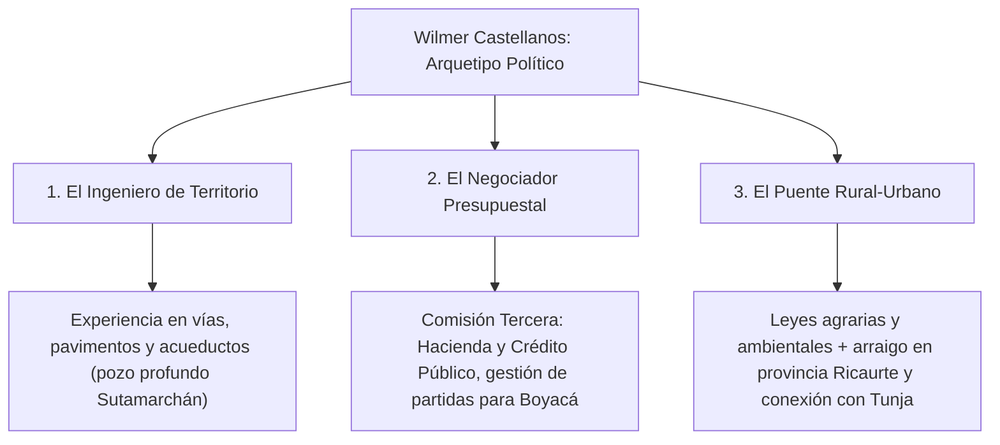
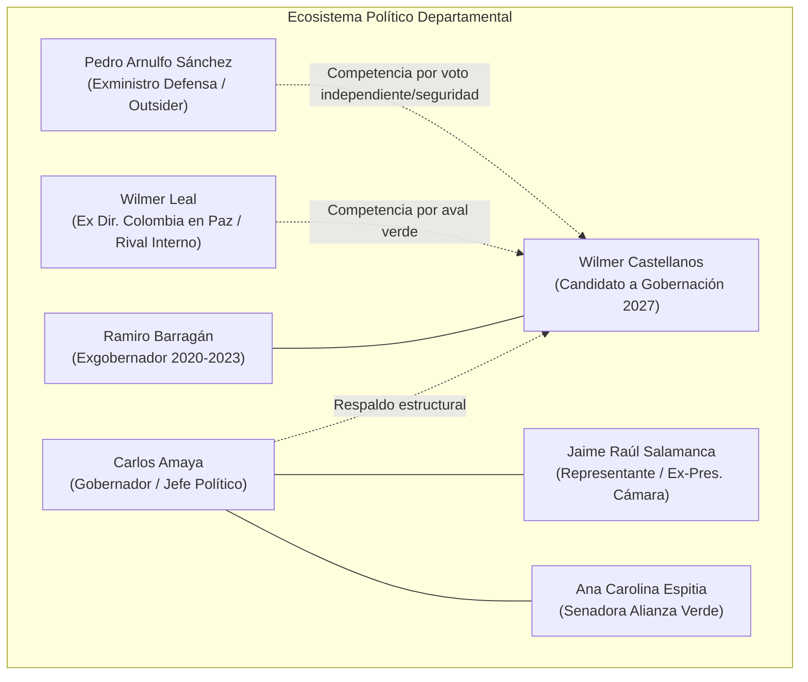
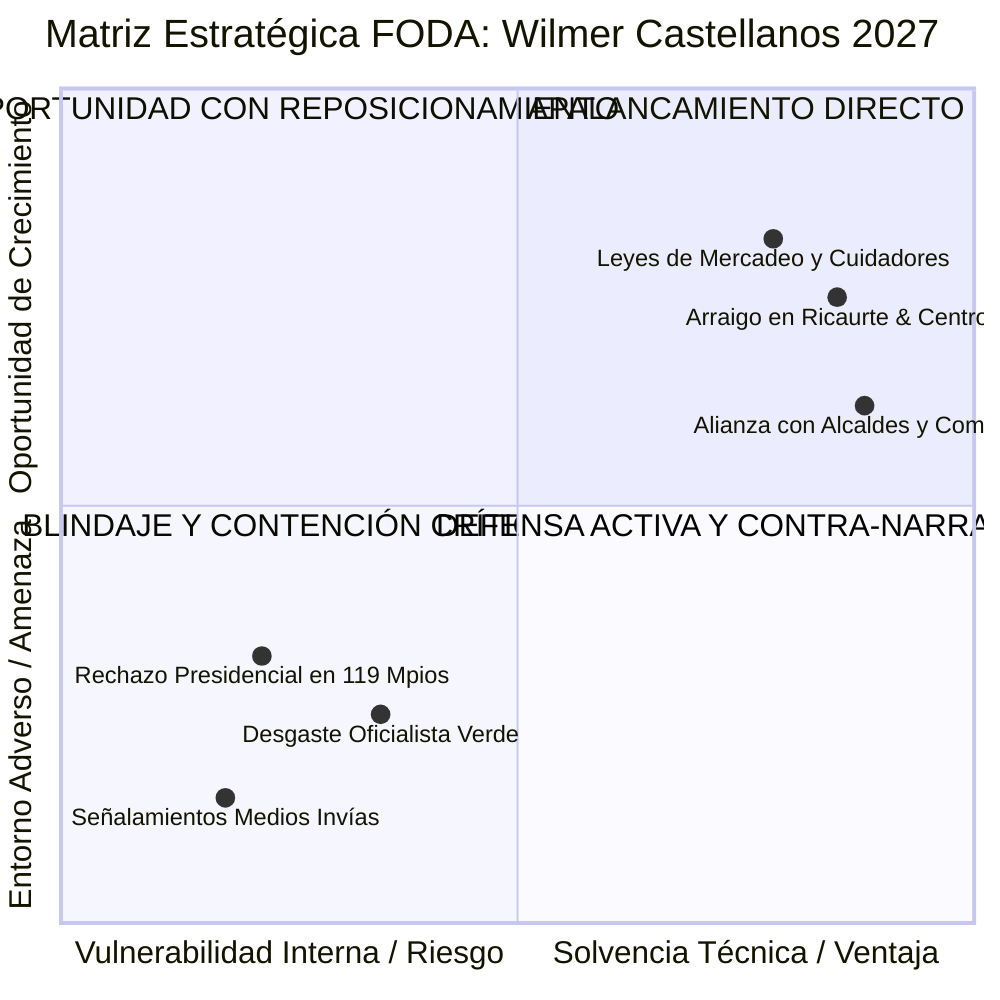
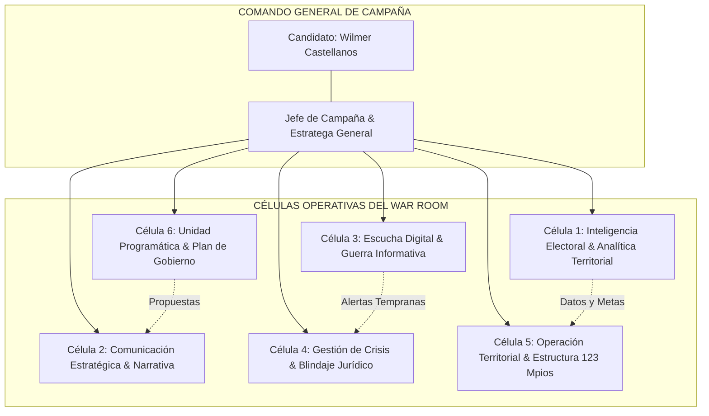
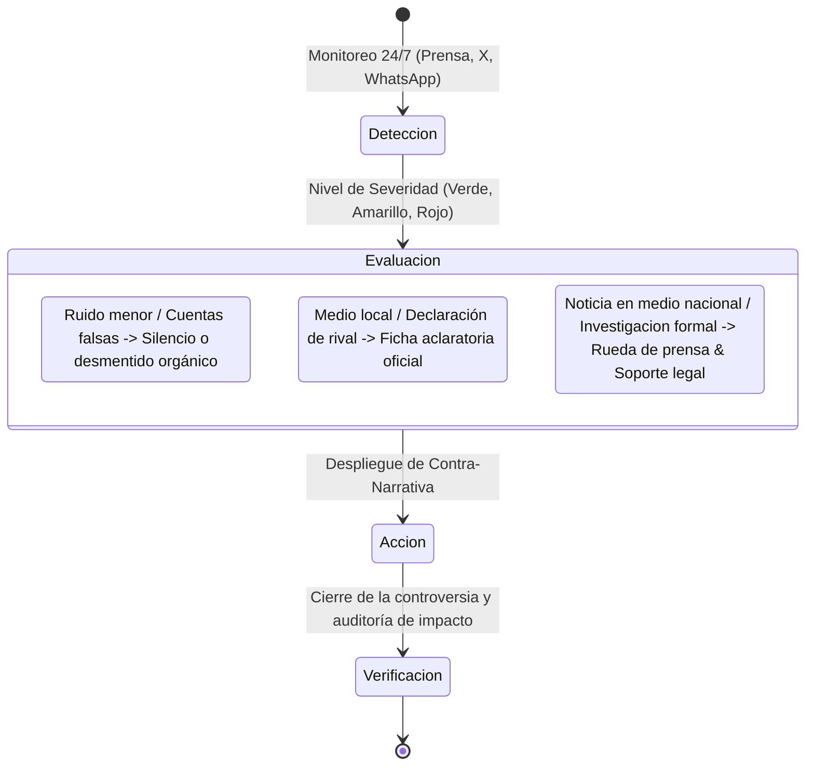

# WAR ROOM POLÍTICO BOYACÁ 2027: WILMER CASTELLANOS
## Dossier Estratégico, Perfilamiento del Candidato y Centro de Inteligencia Electoral (Gobernación 2028–2031)

---

### Resumen Ejecutivo y Marco Estratégico

El presente documento constituye la arquitectura estratégica integral del **War Room de Campaña** y el **Perfilamiento Puntual y Preciso** de **Wilmer Yair Castellanos Hernández** de cara al proceso electoral de octubre de 2027 para la **Gobernación de Boyacá (periodo constitucional 2028–2031)**.

Wilmer Castellanos representa el arquetipo de **"El Ingeniero Territorial"**: un líder joven (38 años) pero con una trayectoria de madurez administrativa escalonada en los tres niveles clave del poder público: **municipal** (Alcalde de Sutamarchán 2016–2019), **departamental** (Director de Infraestructura Vial de Boyacá 2020–2021) y **nacional** (Representante a la Cámara 2022–2026, Comisión Tercera de Hacienda y Presupuesto).

El reto táctico fundamental de esta campaña radica en capitalizar la robusta maquinaria institucional del sector liderado por el gobernador **Carlos Amaya** y el Partido Alianza Verde, mientras se blinda la candidatura del desgaste natural del oficialismo y de la reciente señal de alarma electoral registrada en las presidenciales de 2026, donde el voto departamental castigó al sector en 119 de los 123 municipios. La respuesta estratégica debe ser **técnica, despolarizada, campesina y de infraestructura real**.

---

---

## 1. Perfilamiento Preciso y Puntual del Candidato

### 1.1. Ficha Biográfica y Factual

| Variable | Detalle Verificado |
| :--- | :--- |
| **Nombre Completo** | Wilmer Yair Castellanos Hernández |
| **Fecha de Nacimiento** | 5 de agosto de 1988 (Tunja, Boyacá) — 38 años de edad |
| **Filiación Partidista** | Partido Alianza Verde (Sector institucional / amaysmo) |
| **Formación Académica** | • Ingeniero Civil. • Especialista en Gobierno y Gestión Territorial. • Especialista en Vías y Pavimentos. • Especialista en Gestión Ambiental. |
| **Trayectoria Pública** | • **2016–2019**: Alcalde Municipal de Sutamarchán. • **2020–2021**: Director de Infraestructura Vial, Gobernación de Boyacá. • **2022–2026**: Representante a la Cámara por Boyacá (Comisión Tercera). |
| **Base Electoral Histórica** | **37.302 votos** (Elecciones al Congreso 2022 — 8,10% del total departamental de Cámara). |
| **Estado Electoral Actual** | Renuncia voluntaria a la curul de la Cámara radicada en mayo de 2026, con efectos jurídicos desde el 4 de junio de 2026, evitando la inhabilidad legal para aspirar a cargos uninominales en octubre de 2027. |

---

### 1.2. Arquetipo Político y Atributos Diferenciales

Castellanos no se proyecta como el orador ideológico tradicional, sino como el **gestor técnico de soluciones tangibles**:

* **El Ejecutor Comprobado:** Frente al discurso etéreo, su carta de presentación son metros cúbicos de concreto, kilómetros de placa huella, soluciones de agua potable (acueducto y pozos) y maquinaria amarilla.
* **Solvencia en Finanzas Públicas:** Su paso por la Comisión Tercera del Congreso le otorga credibilidad para discutir sobre regalías, crédito de fomento territorial, presupuesto general de la nación (PGN) e inversión descentralizada.
* **Juventud con Escalafón Completo:** Representa un recambio generacional que, a diferencia de otros jóvenes aspirantes, ya fue alcalde, secretario de despacho departamental y legislador.

---

### 1.3. Huella Legislativa: Tres Leyes de la República

Su paso por el Congreso no se limitó al control político; consolidó tres leyes de alto impacto social y económico que sirven como banderas programáticas irrebatibles:

1. **Ley 2378 de 2024 (Mercadeo Agropecuario):**
   * *Propósito:* Establece los lineamientos para la política nacional de mercadeo agropecuario.
   * *Narrativa de Campaña:* Defensa directa del campesino boyacense frente a los intermediarios abusivos. Reducción de costos logísticos y centros de acopio provinciales.
2. **Ley 2427 de 2024 (Educación Ambiental y Cambio Climático):**
   * *Propósito:* Obligatoriedad de la formación en sostenibilidad, cambio climático y prevención de desastres.
   * *Narrativa de Campaña:* Conexión con la identidad ecológica de Boyacá (páramos, cuencas hídricas del Chicamocha y Sugamuxi, transición productiva).
3. **Ley 2456 de 2025 (Cuidadores y Personas con Discapacidad):**
   * *Propósito:* Creación de fondos de protección, transferencias y redes de apoyo a cuidadores familiares y población en situación de discapacidad.
   * *Narrativa de Campaña:* Sensibilidad social y enfoque de cuidado humano que balancea el perfil de "ingeniero duro de obras públicas".

---

## 2. Mapa de Poder y Relaciones Políticas

El tablero de poder en Boyacá gira en torno a tres círculos concéntricos de influencia:

### 2.1. Dinámica de Fuerzas Internas y Externas

* **El Respaldo del Gobernador Carlos Amaya:** Es el activo organizativo más potente del departamento. Sin embargo, no se debe formalizar un "dedazo" prematuro que unifique a la oposición. Se requiere un proceso de legitimación mediante consenso de bancadas y consulta de sectores sociales.
* **Tensión con Wilmer Leal:** Ambos provienen del núcleo verde. Mientras Leal mantiene puentes con sectores de la izquierda nacional y el progresismo petrista, Castellanos encarna el centro técnico-verde territorial. La estrategia exige ganar el aval verde por encuesta interna o acuerdo de coalición programática amplia.
* **El Reto Pedro Arnulfo Sánchez (Exministro de Defensa):** Representa la carta del orden, la seguridad y la autoridad en un momento en que el campo y el comercio exigen tranquilidad ante hechos de extorsión y delincuencia en corredores fronterizos (Boyacá-Casanare, Boyacá-Santander, Occidente esmeraldero). Castellanos debe incorporar una agenda robusta de seguridad rural y tecnología en vías para neutralizar este flanco.
* **Bancada Parlamentaria y Asamblea:** La alianza natural con Jaime Raúl Salamanca (con amplios votos en el magisterio y sector salud) y con Ramiro Barragán (base burocrática y comunal provincial) es la columna vertebral de la defensa territorial.

---

## 3. Matriz FODA Integral (Estratégica & Electoral)

### Fortalezas (F)
1. **Hoja de vida coherente:** Único aspirante con experiencia directa demostrada en alcaldía, secretaría departamental de obras y Congreso.
2. **Resultados tangibles:** Autor de 3 leyes aprobadas y promulgadas.
3. **Estructura base sólida:** 37.302 votos propios en 2022 y red capilar de ediles y concejales en provincia de Ricaurte, Centro y Tundama.
4. **Capacidad de estructuración:** Ingeniero con dominio de pliegos, regalías, OCAD y contratación pública territorial.

### Oportunidades (O)
1. **Descentralización del presupuesto:** El clamor de las provincias periféricas (Norte, Gutiérrez, Occidente, Lengupá, La Libertad) por obras viales no ejecutadas.
2. **Coalición multipartidista:** Construir una convergencia más amplia que Alianza Verde (apelar a sectores liberales, conservadores independientes y de base comunitaria).
3. **Voto rural y campesino:** Capitalizar la Ley 2378 de 2024 de mercadeo agrario como la gran promesa de alivio financiero a los paperos, cebolleros y ganaderos.

### Debilidades (D)
1. **Reconocimiento espontáneo asimétrico:** Fuerte penetración en Ricaurte y Tunja, pero menor familiaridad en provincias del Norte, Valderrama y Puerto Boyacá.
2. **Identificación estrecha con el continuismo:** Riesgo de ser etiquetado como "el candidato de la gobernación", heredando los desgastes acumulados de tres periodos de gobierno afín.
3. **Brecha digital:** Presencia en redes sociales relativamente modesta (~4.000 seguidores en X) y baja producción de contenido multimedia de alta retención viral.

### Amenazas (A)
1. **Efecto rechazo nacional (Ola antipetro/antiverde):** La derrota del oficialismo en 119 de 123 municipios en las presidenciales de 2026 demuestra que el electorado boyacense está dispuesto a votar masivamente contra el establecimiento cuando se siente desatendido.
2. **Ataques reputacionales por caso Invías:** Filtraciones periodísticas recurrentes que buscan asociar gestiones institucionales con presunta cartelización contractual.
3. **Dispersión del voto oficialista:** Disputa no resuelta con Wilmer Leal o fracturas dentro de la bancada verde de la Asamblea.

---

## 4. Radiografía Electoral Territorial de Boyacá

### 4.1. Análisis de la Huella Electoral 2022 (Base de Comparación)

En 2022, Wilmer Castellanos obtuvo **37.302 votos**. El análisis de concentración en las principales cabeceras evidencia su distribución geográfica:

| Municipio / Provincia | Votos Registrados (2022) | % sobre Votos Totales de WC | Diagnóstico Táctico 2027 |
| :--- | :--- | :--- | :--- |
| **Tunja (Prov. Centro)** | **4.311** | 11,56% | Capital departamental. Requiere discurso de modernización, movilidad y empleo juvenil. |
| **Sogamoso (Prov. Sugamuxi)** | **2.605** | 6,98% | Polo industrial y comercial. Debe enfatizarse la infraestructura logística y medio ambiente. |
| **Chiquinquirá (Prov. Occidente)** | **2.125** | 5,70% | Centro religioso y comercial. Urge plan de reactivación y seguridad regional. |
| **Duitama (Prov. Tundama)** | **1.422** | 3,81% | La "Perla de Boyacá". Tradicionalmente esquiva al verde; exige acuerdos con empresarios y transportadores. |
| **Paipa (Prov. Tundama)** | **518** | 1,39% | Eje turístico y hotelero. Oferta de ecoturismo y sostenibilidad. |
| **Garagoa (Prov. Neira / Valle de Tenza)** | **201** | 0,54% | Plaza baja. Requiere giras de penetración profunda y alianzas con líderes comunales. |
| **Soatá (Prov. Norte)** | **158** | 0,42% | Históricamente marginada en conectividad. Oferta central: Hospital regional y vías terciarias. |
| **Resto de Municipios (Sutamarchán, Ricaurte, etc.)** | **~25.963** | 69,60% | **Su gran bastión:** El voto rural disperso y las provincias intermedias (Ricaurte, Márquez, Lengupá). |

> [!IMPORTANT]
> **Lección de los Datos:** El 70% de la fuerza electoral de Wilmer Castellanos descansa en las provincias intermedias y municipios de categoría 5 y 6. Para ganar la Gobernación, donde el censo total exige superar los **180.000 – 220.000 votos**, no basta con retener el campo: **es obligatorio crecer en el corredor industrial Tunja–Duitama–Sogamoso**, que concentra más del 40% del electorado activo de Boyacá.

---

## 5. Diseño Estructural del War Room de Campaña

El **War Room** funcionará como un centro de comando unificado de alta tecnología política, articulando inteligencia de datos, narrativa en tiempo real, despliegue en territorio y control de contingencias.

---

### 5.1. Funciones de las 6 Células Especializadas

#### Célula 1: Inteligencia Electoral y Analítica Territorial
* **Misión:** Administrar el Atlas Electoral de Boyacá en tiempo real.
* **Entregables:**
  * Cuota de votación objetivo por municipio, puesto y mesa de votación.
  * Monitoreo de inscripción de cédulas y variaciones del censo electoral.
  * Segmentación sociodemográfica (mujeres rurales, jóvenes universitarios de Tunja, transportadores de Duitama, mineros de carbón y esmeralderos).

#### Célula 2: Comunicación Estratégica, Narrativa y Prensa
* **Misión:** Posicionar el relato de campaña: *"Boyacá Construye Futuro: Experiencia que Une y Transforma"*.
* **Líneas discursivas:**
  * **La vía de las soluciones:** Castellanos como el hombre que conecta veredas y pavimenta el desarrollo.
  * **El campo con plata en el bolsillo:** Explicación sencilla de la Ley de Mercadeo Agropecuario (precios justos para la papa y la leche).
  * **Cuidado familiar:** La Ley de cuidadores como testimonio de vocación humana.

#### Célula 3: Escucha Digital y Guerra Informativa
* **Misión:** Transformar la presencia digital del candidato mediante microsegmentación de contenidos en TikTok, Instagram y WhatsApp comunitarios.
* **Estrategia Digital:**
  * Elevar la base de seguidores mediante formatos dinámicos ("El Ingeniero responde en obra", videos de 45 segundos explicando cómo funciona un pozo profundo o cómo se repara una vía).
  * Creación de la **Red de Mensajería Ciudadana Boyacá al Día** (canales de WhatsApp veredales para distribución directa de contenido sin intermediación algorítmica).

#### Célula 4: Gestión de Crisis y Blindaje Jurídico
* **Misión:** Contención de guerra sucia, desactivación de infundios sobre Invías y garantía del cumplimiento estricto del régimen de inhabilidades y topes de gasto.
* **Herramienta clave:** Semáforo de Alertas Reputacionales y protocolos de respuesta en menos de 90 minutos.

#### Célula 5: Operación Territorial (Estructura de los 123 Municipios)
* **Misión:** Articulación con diputados, alcaldes en ejercicio, exalcaldes, concejales y juntas de acción comunal (JAC).
* **Organización:** 13 coordinaciones provinciales (Centro, Ricaurte, Sugamuxi, Tundama, Occidente, Neira, Oriente, Lengupá, Márquez, Norte, Gutiérrez, Valderrama, La Libertad y Zona Especial Puerto Boyacá).

#### Célula 6: Unidad Programática y Plan de Gobierno
* **Misión:** Redacción del Programa de Gobierno oficial exigido por la Registraduría con viabilidad fiscal rigurosa.
* **Ejes temáticos:** Conectividad vial terciaria, seguridad hídrica, modernización del agro, transición energética justa y salud preventiva provincial.

---

## 6. Protocolo de Gestión de Crisis Reputacional

Dada la exposición del candidato a controversias sobre contratación pública y desinformación en redes, el War Room operará bajo el siguiente protocolo estándar de contingencia:

### Protocolo Específico: Caso Señalamientos de Contratación (Invías / Infraestructura)
1. **Regla de Oro:** *Nunca polemizar sobre hipótesis sin sustento; responder con certificados de obra y autos judiciales oficiales.*
2. **Mensaje Matriz Unificado:**
   > *"Wilmer Castellanos es un profesional de la ingeniería que ha dedicado su vida a gestionar recursos transparentes para las comunidades más apartadas de Boyacá. Su gestión legislativa y técnica cuenta con total trazabilidad en el SECOP y en los entes de control. No tiene sanciones ni requerimientos condenatorios; su mejor testigo son las obras concluidas que hoy disfrutan los campesinos de Boyacá."*
3. **Carpeta de Desmentido Rápido (Drive Blindado):**
   * Certificados de paz y salvo de Contraloría, Procuraduría y Fiscalía.
   * Fichas de avance y actas de liquidación formal de las obras de Sutamarchán y de la Gobernación.
   * Respuestas oficiales ya radicadas ante las instancias correspondientes.

---

## 7. Plan Estratégico de Campaña: Cronograma en 4 Fases

| Fase | Ventana Temporal | Objetivo Estratégico | Hito de Cierre |
| :--- | :--- | :--- | :--- |
| **Fase 1: Consolidación & Blindaje** | Octubre 2026 – Enero 2027 | Cierre de heridas internas en Alianza Verde; acuerdo político con Carlos Amaya; auditoría jurídica total. | Candidatura de consenso o mecanismo de escogencia acordado. |
| **Fase 2: Conquista de Provincias** | Febrero 2027 – Mayo 2027 | Gira *"El Ingeniero Escucha"*: Asambleas veredales en los 123 municipios; talleres del Plan de Gobierno. | Presentación del borrador del Programa de Gobierno Departamental. |
| **Fase 3: Coalición Abierta & Inscripción** | Junio 2027 – Julio 2027 | Consolidación de la gran coalición por Boyacá (adhesión de fuerzas independientes, liberales, comunales). | Inscripción oficial ante la Registraduría con programa registrado. |
| **Fase 4: Despliegue Total & Defensa del Voto** | Agosto 2027 – Octubre 2027 | Campaña abierta masiva; debates públicos; blitz publicitario en medios y redes; montaje del ejército de 3.500 testigos electorales. | **Día D: Victoria electoral el último domingo de octubre de 2027.** |

---

## 8. Tablero de Indicadores Clave de Desempeño (KPIs de Campaña)

El comando de campaña evaluará semanalmente los siguientes parámetros de control:

| Dimensión | Indicador Clave (KPI) | Meta de Campaña | Estado Actual (Línea Base) |
| :--- | :--- | :--- | :--- |
| **Electoral** | Votos Objetivo Departamentales | **210.000 votos** | 37.302 (Base propia 2022) |
| **Reconocimiento** | Nivel de Conocimiento Espontáneo | > 65% en Boyacá | Estimado ~35% (Concentrado en Centro/Ricaurte) |
| **Opinión** | Imagen Favorable Neta | > +40% de balance positivo | Por medir en primera ola de encuesta |
| **Digital** | Audiencia e Interacción Mensual | > 1.500.000 personas alcanzadas | < 100.000 personas |
| **Territorial** | Comités de Campaña Activos | 123 municipios con comité formal | ~25 municipios con enlace directo |
| **Electoral (Día D)** | Cobertura de Testigos Electorales | 100% de las mesas de votación | 0% (Fase preparatoria) |

---

## Conclusión y Recomendación Directiva

Wilmer Yair Castellanos Hernández cuenta con las credenciales técnicas, legislativas y territoriales para convertirse en el próximo Gobernador de Boyacá. La clave de la victoria no residirá en la inercia partidista, sino en su capacidad para **personalizar una propuesta de gerencia de obras, autonomía regional y bienestar campesino**, demostrando que su visión trasciende las fronteras partidistas y responde al anhelo boyacense de estabilidad, progreso y honestidad técnica en la administración pública.
